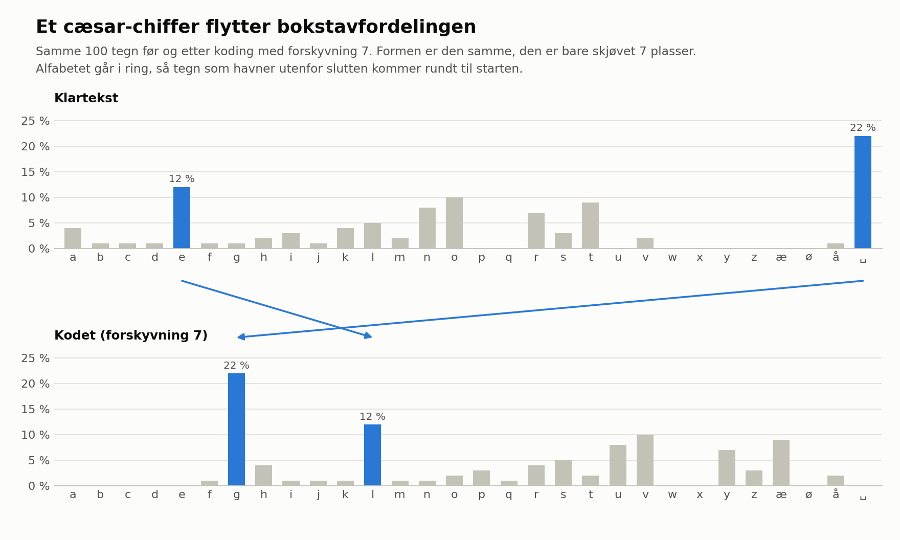
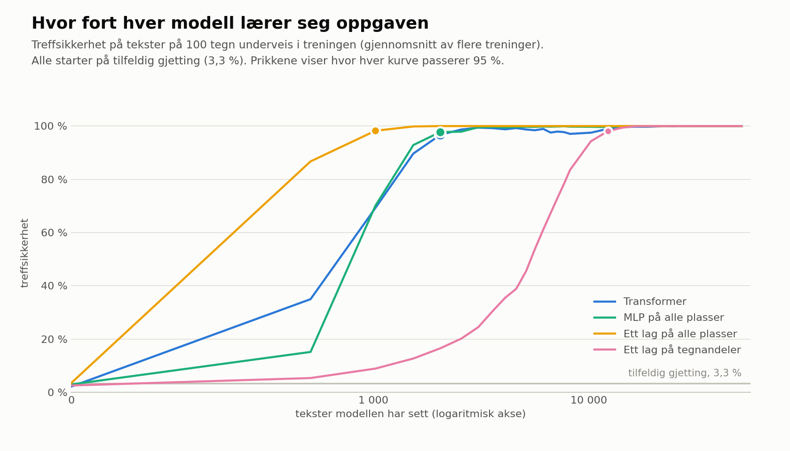
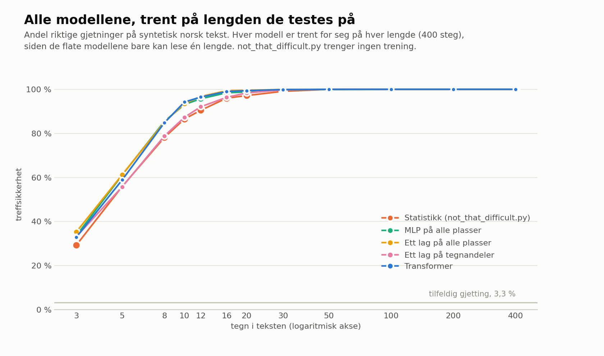

# Knekke cæsar-chiffer med et transformer-nettverk

*Kort versjon av `caesar_cracker.ipynb`. Alle tall er hentet fra notebooken.*

**Oppgave.** Teksten er kodet ved at hvert tegn er flyttet *k* plasser i alfabetet (a–z, æ, ø, å og mellomrom, 30 tegn). Finn *k* uten å kjenne den, og skriv ut klarteksten.

**Idé.** Et cæsar-chiffer endrer ikke hvor ofte hvert tegn forekommer, det flytter bare fordelingen sidelengs. Norsk har en tydelig fordeling, så riktig forskyvning er den som får teksten til å ligne norsk igjen.



## Løsningen: den dummeste vi kom på

Et lite **transformer-nettverk** (103 838 parametre) leser de kodede tegnene og velger én av 30 forskyvninger. Ingenting om telling, frekvenser eller cæsar-chiffer er bygget inn. Det lærer av **syntetiske tekster** vi lager selv fra `vanligst.csv`: 51 200 tekster på 50–150 tegn, **4 sekunder** på GPU.

## Trappen: går det an å være dummere?

Vi tok bort ting trinn for trinn og trente hver modell likt (100 tegn, 200 steg, snitt av 3 treninger). Til slutt kommer `not_that_difficult.py`, som bare teller bokstaver og sammenligner med frekvenstabellen (chi-kvadrat).

| Modell | Parametre | Treningstid | Treff, syntetisk | Treff, ekte tekst |
|---|---:|---:|---:|---:|
| Transformer | 103 838 | 3,6 s | 100 % | 91,4 % |
| MLP på alle plasser | 841 758 | 0,6 s | 100 % | 91,2 % |
| Ett lag på alle plasser | 90 030 | 0,5 s | 100 % | 91,9 % |
| Ett lag på tegnandeler | 930 | 0,6 s | 100 % | 91,7 % |
| **Statistikk** (`not_that_difficult.py`) | **0** | **0 s** | – | **94,1 %** |

*Ekte tekst = 3 403 tegn fra oppgave-PDF-en, kuttet i vinduer på 100 tegn.*

Alle modellene ender på det samme, selv den minste, som er logistisk regresjon på tegnandeler og i praksis den klassiske metoden tegnet som et nettverk. De lærer ikke like fort:



## Hvor godt virker det?

**Fire eksempelfiler:** nettverket klarte 4 av 4, statistikken 3 av 4 (den bommer på den korte `i4.txt`).

**Ekte norsk tekst**, etter vindulengde:

| Vindu | Nettverk | Statistikk |
|---:|---:|---:|
| 30 tegn | 90,4 % | 88,5 % |
| 50 tegn | 92,5 % | 91,2 % |
| 100 tegn | 91,7 % | 94,1 % |

Omtrent uavgjort, med små forskjeller som går begge veier.

**Korte tekster.** Transformeren ble bare trent på 50–150 tegn, så den er svak utenfor det. Trent og testet på samme lengde ligger nettverkene på eller over statistikken (syntetisk tekst):

| Modell | 10 tegn | 30 tegn |
|---|---:|---:|
| Transformer | 94,2 % | 99,9 % |
| MLP på alle plasser | 93,1 % | 99,7 % |
| Ett lag på alle plasser | 93,5 % | 100 % |
| Ett lag på tegnandeler | 87,3 % | 99,8 % |
| Statistikk | 86,5 % | 99,1 % |



## Konklusjon

- **Nettverket virker.** Det fant ut av noen tusen eksempler at bokstavfordelingen er det som teller, uten å få vite det.
- **Men prisen står ikke i forhold til det det gir.** Treffsikkerheten er omtrent lik statistikkens, men nettverket trenger 103 838 parametre, 51 200 treningstekster, en datagenerator og en treningsløkke (92 linjer kode mot 32 for statistikken).
- **Det er en sirkel i det:** nettverket lærte frekvensene fra tekster vi genererte fra frekvensene. ML passer når man ikke kjenner strukturen i problemet, og her gjorde vi det.

*Merk: tallene er fra én kjøring. GPU-trening gir små forskjeller mellom kjøringer, og tabellen for korte tekster har én trening per tall.*

## Kjør selv

```
python crack_caesar.py train      # trener og lagrer modellen
python plot_caesar.py             # lager figurene i plots/
jupyter notebook caesar_cracker.ipynb
```
